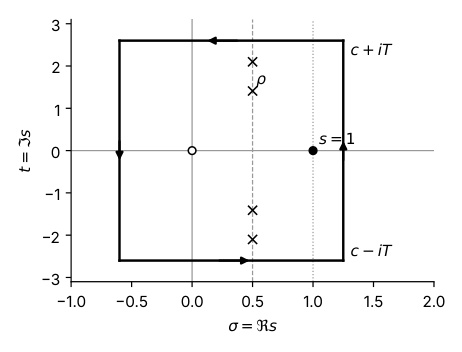

# A Truncated Perron Formula and Short Sums of $\Lambda(n)$ in Arithmetic Progressions

Ada N. Example and Ben Q. Placeholder

**Abstract.** We give a self-contained proof of an explicit truncated form of Perron's formula for Dirichlet series $F(s) = \sum_{n \geq 1} a_n n^{-s}$ with $|a_n| \leq A(n)$, and use it to estimate $\psi(x; q, a) = \sum_{n \leq x, n \equiv a \bmod q} \Lambda(n)$ in short intervals $[x, x + h]$ with $h = x^{\theta}$, $\theta > 7/12$.

# 1. Introduction

Let $\Lambda$ denote the von Mangoldt function, so that $\Lambda(n) = \log p$ if $n = p^k$ is a prime power and $\Lambda(n) = 0$ otherwise, and let

$$
\psi(x) = \sum_{n \leq x} \Lambda(n) = \sum_{p^k \leq x} \log p. \tag{1.1}
$$

The Prime Number Theorem in the form $ \psi(x) \sim x $ is equivalent to the non-vanishing of the Riemann zeta function on the line $\Re s = 1$, and the strongest known error term,

$$\psi(x) = x + O\left(x \exp\left(-c \frac{(\log x)^{3/5}}{(\log \log x)^{1/5}}\right)\right), \tag{1.2}$$

comes from the Vinogradov–Korobov zero-free region [\[4,](#page-5-3) [6\]](#page-5-5). The link between $\psi$ and the zeros of $\zeta(s)$ is Perron's formula.1

1All implied constants are absolute unless indicated otherwise; we write $f \ll g$ for $f = O(g)$.

# 2. Preliminaries and Perron's formula

## 2.1. A discontinuous integral

For $y > 0$ and $c > 0$ define the step function

$$
\delta(y) = \begin{cases} 0 & \text{if } 0 < y < 1, \\ \frac{1}{2} & \text{if } y = 1, \\ 1 & \text{if } y > 1. \end{cases} \tag{2.1}
$$

**Lemma 2.1.** *Let* $c > 0$, $y > 0$ *and* $T > 0$, *and put* $I(y, T) = \frac{1}{2\pi i} \int_{c - iT}^{c + iT} y^s \frac{ds}{s}$. *Then*

$$
|I(y,T) - \delta(y)| < \begin{cases} y^c \min\left(1, \frac{1}{T|\log y|}\right) & \text{if } y \neq 1, \\ \frac{c}{T} & \text{if } y = 1. \end{cases} \tag{2.2}
$$

*Proof.* Suppose $y > 1$. By Cauchy's theorem applied to the rectangle with vertices $c \pm iT$ and $-U \pm iT$, and letting $U \to \infty$,

$$
\begin{aligned} I(y,T) - 1 &= -\frac{1}{2\pi i} \left( \int_{-\infty + iT}^{c + iT} - \int_{-\infty - iT}^{c - iT} \right) y^s \frac{ds}{s}, \\ \left| \int_{-\infty \pm iT}^{c \pm iT} y^s \frac{ds}{s} \right| &\leq \frac{1}{T} \int_{-\infty}^{c} y^{\sigma} d\sigma = \frac{y^c}{T \log y}. \end{aligned}
$$

The case $0 < y < 1$ is symmetric. $\square$

Figure 1. The contour used in the proof of [Lemma 3.1:](#page-1-1) the segment $[c - iT, c + iT]$ is shifted to the left of the critical line.

**Theorem 3.2.** *Let* $\varepsilon > 0$ *and* $\theta > \frac{7}{12} + \varepsilon$. *Then*

$$\psi(x+h;q,a)-\psi(x;q,a) = \frac{h}{\varphi(q)}\left(1+O\left(\exp\left(-c\frac{\log x}{(\log\log x)^{2/3}}\right)\right)\right)\tag{3.3}$$

A formula marker mis-recognised: $\mathcal{S}_k \xrightarrow{\Lambda} \badmacro{D}$, shown as TeX.

| Density estimate | exponent $A(\sigma)$ | admissible $\theta$ |
|------------------|----------------------|---------------------|
| Ingham (1937) | $\frac{3}{2-\sigma}$ | $\theta > \frac{5}{8}$ |
| Huxley (1972) | $\frac{12}{5}$ | $\theta > \frac{7}{12}$ |
| Density Hypothesis | $2$ | $\theta > \frac{1}{2}$ |

## References

- [1] H. Davenport, *Multiplicative number theory*, third ed., Graduate Texts in Mathematics, vol. 74, Springer-Verlag, New York, 2000.
- [4] N. M. Korobov, *Estimates of trigonometric sums and their applications*, Uspehi Mat. Nauk 13 (1958), no. 4, 185–192.
- [6] I. M. Vinogradov, *A new estimate of the function* $\zeta(1 + it)$, Izv. Akad. Nauk SSSR. Ser. Mat. 22 (1958), 161–164.
